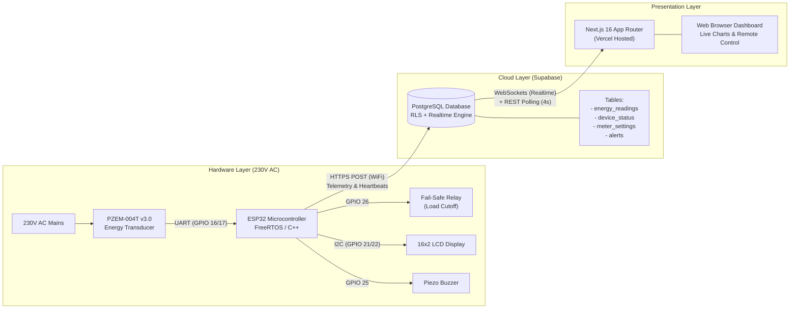

# ⚡ Smart Energy Meter IoT & Web Monitoring Platform

[](https://nextjs.org/)
[](https://react.dev/)
[](https://www.typescriptlang.org/)
[](https://supabase.com/)
[](https://www.espressif.com/)
[](LICENSE)

An enterprise-ready, IoT-enabled AC electrical energy metering, diagnostic, and protection system. Built around an **ESP32 DevKit** micro-controller and **PZEM-004T v3.0** precision power transducer, this project provides real-time telemetry, automated electrical fault protection, sub-second cloud synchronization via **Supabase**, and a live **Next.js 16 App Router** management dashboard.

---

## 📑 Table of Contents

- [Key Features](#-key-features)
- [System Architecture](#-system-architecture)
- [Hardware Specifications & Pinout](#-hardware-specifications--pinout)
- [Repository Structure](#-repository-structure)
- [Database Setup & Migrations](#-database-setup--migrations)
- [Firmware Setup (ESP32)](#-firmware-setup-esp32)
- [Web Dashboard (Next.js 16)](#-web-dashboard-nextjs-16)
- [Live Deployment on Vercel](#-live-deployment-on-vercel)
- [IoT Load Simulator](#-iot-load-simulator)
- [Electrical Safety Warning](#-electrical-safety-warning)
- [License](#-license)

---

## 🌟 Key Features

- **High-Precision AC Telemetry**: Accurately measures Voltage ($V$), Current ($A$), Active Power ($W$), Energy Consumption ($kWh$), Line Frequency ($Hz$), and Power Factor ($PF$) using the PZEM-004T v3.0 sensor.
- **Fail-Safe Relay Protection**: Hardware-level automated load shedding for over-voltage ($>240\text{V}$), under-voltage ($<200\text{V}$), and over-current events with Normally-Closed (NC) relay failsafe wiring.
- **Hardened Cloud Uplink**: Resilient HTTPS REST & WebSocket telemetry pipeline to Supabase with automatic public DNS fallback (`8.8.8.8`, `1.1.1.1`) to resolve ISP DNS filtering.
- **NTP Clock Synchronization**: Embedded SNTP time synchronization ensuring every telemetry record and safety alert contains an RFC 3339 / ISO-8601 UTC timestamp (`YYYY-MM-DDTHH:MM:SSZ`).
- **Interactive Web Dashboard**: Built with Next.js 16, React 19, and Recharts, featuring dark-mode UI, live chart telemetry buffers, instant device status indicators, threshold configuration, and an alert audit log.
- **Dual-Mode Operation**: Seamlessly supports physical ESP32 hardware and headless TypeScript load simulation for testing and demonstrations without high-voltage equipment.

---

## 🏗️ System Architecture



---

## 🔌 Hardware Specifications & Pinout

### ESP32 DevKit v1 Pin Assignments

| Component | Pin Function | ESP32 GPIO | Description / Notes |
| :--- | :--- | :--- | :--- |
| **PZEM-004T v3.0** | `TX` (Transmitter) | `GPIO 16` (`RX2`) | Hardware Serial 2 Receive |
| **PZEM-004T v3.0** | `RX` (Receiver) | `GPIO 17` (`TX2`) | Hardware Serial 2 Transmit |
| **5V Relay Module** | `IN1` (Signal) | `GPIO 26` | Active-LOW control; wired to NC (Normally Closed) |
| **I2C LCD 1602** | `SDA` (Data) | `GPIO 21` | Standard ESP32 I2C Data |
| **I2C LCD 1602** | `SCL` (Clock) | `GPIO 22` | Standard ESP32 I2C Clock |
| **Piezo Buzzer** | `Positive (+)` | `GPIO 25` | Audible alert for trip conditions |
| **Status LED** | Built-in LED | `GPIO 2` | Heartbeat & Wi-Fi indicator |

### Relay Fail-Safe Wiring Logic

The protection relay is wired in a **Normally Closed (NC)** configuration:
- **Normal Operation**: Relay coil is unenergized (`GPIO 26 = HIGH`). Mains power flows through `COM` $\rightarrow$ `NC` to the load.
- **Fault Condition / Trip**: Relay coil is energized (`GPIO 26 = LOW`). The `NC` contact opens, physically isolating the load within milliseconds.
- **Fail-Safe Mechanism**: In the event of firmware crash, reboot, or total micro-controller power loss, the relay remains unpowered or safely trips according to design requirements.

---

## 📁 Repository Structure

```text
smart-energy-meter-iot/
├── Arduino_Projects/
│   └── capstone/                  # Arduino IDE primary sketch
│       ├── capstone.ino
│       ├── secrets.example.h      # Credentials template (untracked: secrets.h)
├── dashboard/                     # Next.js 16 web dashboard
│   ├── src/
│   │   ├── app/                   # App Router pages (/alerts, /analytics, /device, /settings)
│   │   ├── components/            # Reusable UI cards, charts, headers, and layouts
│   │   ├── hooks/                 # Custom React hooks (useRealtimeReadings, useDeviceStatus)
│   │   └── lib/                   # Supabase client, types, and device constants
│   ├── .env.local.example         # Dashboard environment template
│   ├── package.json
│   └── tsconfig.json
├── database/                      # SQL schema migrations & seed files
│   ├── 001_schema.sql
│   ├── 002_rls_policies.sql
│   ├── 003_functions.sql
│   ├── 004_realtime.sql
│   ├── 005_seed.sql
│   ├── 006_grants.sql
│   └── 007_add_hardware_connection.sql
├── docs/                          # Hardware wiring & setup guides
│   ├── HARDWARE_INTEGRATION_GUIDE.md
│   └── supabase-setup.md
├── firmware/
│   ├── smart_energy_meter/        # Production standalone Arduino sketch
│   │   ├── smart_energy_meter.ino
│   │   └── secrets.example.h
│   ├── include/                   # PlatformIO modular C++ headers
│   ├── src/                       # PlatformIO modular C++ source files
│   └── platformio.ini
├── simulator/                     # Headless TypeScript load simulator
│   ├── src/
│   │   ├── index.ts
│   │   └── scenarios.ts           # Over-voltage, under-voltage, over-power simulations
│   └── package.json
├── supabase/                      # Supabase CLI-compatible migrations
│   └── migrations/
├── LICENSE                        # MIT License
├── README.md                      # Project documentation
├── run_dashboard.bat              # One-click dashboard launcher (Windows)
└── run_simulator.bat              # One-click simulator launcher (Windows)
```

---

## 🗄️ Database Setup & Migrations

The database backend is powered by **Supabase (PostgreSQL)**. To provision your database:

1. Create a free project at [supabase.com](https://supabase.com).
2. Open the **SQL Editor** in your Supabase project dashboard.
3. Apply the SQL scripts located in `supabase/migrations/` (or `database/`) in sequential order:
   - `001_schema.sql`: Creates `energy_readings`, `device_status`, `meter_settings`, and `alerts` tables.
   - `002_rls_policies.sql`: Configures Row Level Security (RLS) policies for secure anonymous device access.
   - `003_functions.sql`: Adds stored procedures and triggers for automatic timestamp and status updates.
   - `004_realtime.sql`: Enables Supabase Realtime broadcast on telemetry tables.
   - `005_seed.sql`: Seeds default device status (`esp32-meter-001`) and standard protection thresholds.
   - `006_grants.sql`: Grants required permissions to the `anon` and `authenticated` roles.
   - `007_add_hardware_connection.sql`: Configures hardware connection type enumeration.

---

## ⚡ Firmware Setup (ESP32)

### 1. Arduino IDE Setup

1. Install [Arduino IDE](https://www.arduino.cc/en/software) (version 2.0+ recommended).
2. Add the ESP32 board package:
   - Go to **File** $\rightarrow$ **Preferences** $\rightarrow$ **Additional Board Manager URLs**.
   - Add: `https://raw.githubusercontent.com/espressif/arduino-esp32/gh-pages/package_esp32_index.json`
   - Go to **Tools** $\rightarrow$ **Board** $\rightarrow$ **Boards Manager**, search for `esp32`, and install `esp32 by Espressif Systems`.
3. Install required libraries from the Library Manager (**Tools** $\rightarrow$ **Manage Libraries**):
   - `PZEM-004T v30` by Jakub Mandula (v1.1.2)
   - `ArduinoJson` by Benoit Blanchon (v7.x)
   - `LiquidCrystal_I2C` by Frank de Brabander (v1.1.4)

### 2. Configure Credentials

In `firmware/smart_energy_meter/` (or `Arduino_Projects/capstone/`):
1. Copy `secrets.example.h` to `secrets.h`:
   ```bash
   cp firmware/smart_energy_meter/secrets.example.h firmware/smart_energy_meter/secrets.h
   ```
2. Open `secrets.h` and fill in your actual credentials:
   ```cpp
   #define SECRET_WIFI_SSID      "YOUR_WIFI_SSID"
   #define SECRET_WIFI_PASSWORD  "YOUR_WIFI_PASSWORD"
   #define SECRET_SUPABASE_URL   "https://your-project.supabase.co"
   #define SECRET_SUPABASE_KEY   "your-supabase-publishable-anon-key"
   #define SECRET_SUPABASE_HOST  "your-project.supabase.co"
   #define SECRET_DEVICE_ID      "esp32-meter-001"
   ```
   > **Note:** `secrets.h` is strictly excluded in `.gitignore` and will never be tracked or committed to Git.

### 3. Flash to ESP32

1. Connect the ESP32 DevKit to your computer via USB.
2. Select your board: **Tools** $\rightarrow$ **Board** $\rightarrow$ **ESP32 Arduino** $\rightarrow$ **DOIT ESP32 DEVKIT V1**.
3. Select the COM port: **Tools** $\rightarrow$ **Port**.
4. Click **Upload** (or press `Ctrl+U`).
5. Open **Serial Monitor** at `115200 baud` to observe initialization, Wi-Fi connection, NTP synchronization, and telemetry transmission.

---

## 💻 Web Dashboard (Next.js 16)

The web dashboard provides real-time data visualization, telemetry charting, and remote device monitoring.

### 1. Prerequisites

- [Node.js](https://nodejs.org/) (v18.18.0 or newer; LTS recommended)
- `npm` or `yarn`

### 2. Local Installation

```bash
# Navigate to the dashboard directory
cd dashboard

# Install dependencies
npm install

# Configure environment variables
cp .env.local.example .env.local
```

Edit `dashboard/.env.local` with your Supabase credentials:
```env
NEXT_PUBLIC_SUPABASE_URL=https://your-project.supabase.co
NEXT_PUBLIC_SUPABASE_ANON_KEY=your-supabase-publishable-anon-key
```

### 3. Run Locally

```bash
# Start development server
npm run dev

# Or build for production testing
npm run build
npm run start
```
Open [http://localhost:3000](http://localhost:3000) in your web browser.

---

## 🚀 Live Deployment on Vercel

You can deploy the Next.js dashboard live on [Vercel](https://vercel.com/) with zero server configuration:

1. Push this repository to your GitHub account (see instructions below).
2. Log in to [Vercel](https://vercel.com/) and click **Add New...** $\rightarrow$ **Project**.
3. Import your `smart-energy-meter-iot` GitHub repository.
4. In the **Configure Project** screen:
   - **Framework Preset**: `Next.js`
   - **Root Directory**: Click **Edit** and select `dashboard`
5. Expand **Environment Variables** and add the following two variables:
   - `NEXT_PUBLIC_SUPABASE_URL` = `https://your-project.supabase.co`
   - `NEXT_PUBLIC_SUPABASE_ANON_KEY` = `your-supabase-publishable-anon-key`
6. Click **Deploy**.
7. In approximately 60 seconds, Vercel will provide a secure production HTTPS URL (e.g., `https://smart-energy-meter-iot.vercel.app`).

---

## 🧪 IoT Load Simulator

For development, testing, and continuous integration without live 230V mains, a comprehensive TypeScript simulator is included.

```bash
# Navigate to simulator directory
cd simulator

# Install dependencies
npm install

# Copy environment file and add your Supabase credentials
cp .env.example .env

# Run standard simulation (~230V, ~2A normal load)
npm run dev

# Or simulate specific fault scenarios:
npm run sim:overvoltage    # Simulates >250V spike to trigger over-voltage relay cutoff
npm run sim:undervoltage   # Simulates <180V brownout to trigger under-voltage relay cutoff
npm run sim:overpower      # Simulates high wattage trip
npm run sim:fault          # Simulates sensor communication loss
```

---

## ⚠️ Electrical Safety Warning

> [!CAUTION]
> **HIGH VOLTAGE HAZARD**: This project interfaces directly with 230V AC mains electricity. Mains voltage can cause severe electric shock, permanent injury, or death.
> - Ensure mains power is completely isolated (fuse/MCB disconnected) before wiring or touching any screw terminals on the PZEM-004T or Relay module.
> - Always house the ESP32, relay, and PZEM sensor in an insulated, non-conductive, fire-retardant enclosure.
> - Use properly rated, high-voltage insulated copper wiring ($1.5\text{ mm}^2$ or higher) for all mains connections.
> - If you are not an experienced electrician or engineer certified to handle high-voltage AC, test using the software [Simulator](#-iot-load-simulator) or a safe low-voltage bench power supply.

---

## 📜 License

This project is licensed under the MIT License - see the [LICENSE](LICENSE) file for details.

Developed with ❤️ by **Sumit Midya**.