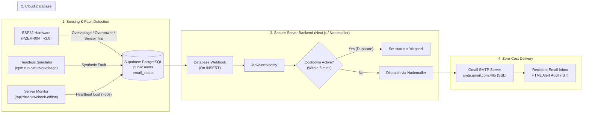

# 📧 Smart Energy Meter: Free Email Alert Notification Guide (Gmail SMTP)

This guide details the complete configuration, deployment, and testing procedure for the **Zero-Cost Email-Only Notification System** using **Gmail SMTP and Nodemailer**.

---

## 🏗️ 1. System Architecture



### Key Safety & Operational Principles
1. **Hardware Relay Independence**: The ESP32's relay cutoff and local buzzer trip execute immediately in hardware. Hardware safety never waits for or depends on network connectivity, Supabase, or Gmail SMTP delivery.
2. **Zero Credentials in Firmware or Frontend**: SMTP user and app passwords reside strictly in `dashboard/.env.local` (and Vercel environment variables). They are never exposed to the ESP32 firmware, GitHub, or browser bundles.
3. **5-Minute Anti-Spam Cooldown**: If an electrical fault persists (e.g. sustained overvoltage), the dispatcher sends the alert immediately on the first occurrence, then suppresses duplicate emails for 5 minutes (`ALERT_COOLDOWN_SECONDS=300`) with status `skipped`.
4. **Server-Side Offline Detection**: Heartbeat staleness (`last_seen > 60s`) is monitored by the server-side endpoint `/api/devices/check-offline`. An offline ESP32 never needs to send its own offline alert.

---

## 🔑 2. Gmail SMTP & Google App Password Setup

To send emails programmatically through Gmail without paying for third-party services, Google requires a **16-character App Password**.

### Step 1: Enable 2-Step Verification
1. Log in to your Google Account at [myaccount.google.com](https://myaccount.google.com/).
2. In the left navigation, click **Security**.
3. Under *How you sign in to Google*, click **2-Step Verification** and follow the prompts to enable it (using SMS or Google Prompt).

### Step 2: Generate an App Password
1. In the search bar at the top of your Google Account page, search for **App passwords** (or go to `Security` $\rightarrow$ `2-Step Verification` $\rightarrow$ scroll to the bottom and click **App passwords**).
2. Enter an app name, such as `Smart Energy Meter`.
3. Click **Create**.
4. Google will display a 16-character password in a yellow box (e.g. `abcd efgh ijkl mnop`).
5. Copy this 16-character password. *(You can paste it with or without spaces; our backend automatically normalizes it).*

> [!CAUTION]
> **Keep your App Password private.** Never share it in chat, never commit it to Git, and never paste it into the ESP32 code.

### Step 3: Google Sending Limits Notice
- Personal `@gmail.com` accounts generally allow up to **500 emails per 24-hour period**.
- Google Workspace accounts allow up to **2,000 emails per day**.
- These limits are enforced dynamically by Google's anti-abuse systems based on account age and reputation. For IoT trip alerts and academic demonstrations, 500 emails/day is more than sufficient.

---

## ⚙️ 3. Environment Variables Configuration

In `dashboard/.env.local` (for local development) and in **Vercel Project Settings $\rightarrow$ Environment Variables** (for production):

```env
# --- Supabase ---
NEXT_PUBLIC_SUPABASE_URL=https://your-project.supabase.co
NEXT_PUBLIC_SUPABASE_ANON_KEY=your-publishable-anon-key
SUPABASE_SERVICE_ROLE_KEY=your-service-role-secret-key

# --- Gmail SMTP (Nodemailer) ---
SMTP_HOST=smtp.gmail.com
SMTP_PORT=465
SMTP_USER=your-email@gmail.com
SMTP_PASS=your-16-char-app-password
ALERT_FROM_EMAIL="Smart Energy Meter" <your-email@gmail.com>
ALERT_TO_EMAIL=your-recipient-email@gmail.com

# --- Security & Anti-Spam ---
ALERT_WEBHOOK_SECRET=your-random-webhook-secret
ALERT_COOLDOWN_SECONDS=300
```

> [!NOTE]
> Whenever you edit `.env.local`, you must restart your Next.js development server (`Ctrl+C`, then `npm run dev` or `run_dashboard.bat`) for changes to take effect.

---

## 🗄️ 4. Supabase Database Migration & Webhook

### SQL Migration
Ensure [supabase/migrations/008_alerts_notification_tracking.sql](file:///c:/Users/sumit/OneDrive/Desktop/capstone_shit/supabase/migrations/008_alerts_notification_tracking.sql) has been run in the Supabase SQL Editor:

```sql
-- 1. Expand alert_type check constraint
ALTER TABLE public.alerts DROP CONSTRAINT IF EXISTS alerts_alert_type_check;
ALTER TABLE public.alerts ADD CONSTRAINT alerts_alert_type_check 
  CHECK (alert_type IN ('over_voltage', 'under_voltage', 'over_power', 'comm_failure', 'sensor_failure', 'device_offline', 'recovery'));

-- 2. Add notification delivery tracking columns
ALTER TABLE public.alerts 
  ADD COLUMN IF NOT EXISTS email_status TEXT NOT NULL DEFAULT 'pending' 
  CHECK (email_status IN ('pending', 'sent', 'failed', 'skipped'));

ALTER TABLE public.alerts 
  ADD COLUMN IF NOT EXISTS delivery_error TEXT;

ALTER TABLE public.alerts 
  ADD COLUMN IF NOT EXISTS notification_sent_at TIMESTAMPTZ;

-- 3. Composite index for fast alert cooldown deduplication queries
CREATE INDEX IF NOT EXISTS idx_alerts_device_type_time 
  ON public.alerts (device_id, alert_type, timestamp DESC);

-- 4. Hardened least-privilege permissions
GRANT SELECT, INSERT, UPDATE, DELETE ON TABLE public.alerts TO service_role;
REVOKE UPDATE ON TABLE public.alerts FROM anon, authenticated;
GRANT SELECT, INSERT ON TABLE public.alerts TO anon, authenticated;
GRANT UPDATE (acknowledged) ON TABLE public.alerts TO anon, authenticated;
```

### Supabase Database Webhook Setup
To trigger automatic email delivery when the ESP32 logs an alert:
1. In your **Supabase Dashboard**, open **Database** $\rightarrow$ **Webhooks**.
2. Click **Create a new webhook**:
   - **Name**: `alerts-email-dispatcher`
   - **Table**: `public.alerts`
   - **Events**: Check **Insert** only.
   - **Type of Webhook**: `HTTP Request`
   - **Method**: `POST`
   - **URL**: `https://<your-vercel-domain>.vercel.app/api/alerts/notify`
   - **HTTP Headers**:
     - `Content-Type`: `application/json`
     - `x-webhook-secret`: `<your-ALERT_WEBHOOK_SECRET>`
3. Click **Create Webhook**.

---

## 🧪 5. Testing & Verification Procedure

### Test 1: One-Click Interactive Test via Dashboard
1. Open the dashboard at `http://localhost:3000/alerts`.
2. Click the **Test Email Alert** button in the top bar.
3. The dashboard executes `/api/alerts/test` (`force: true`), inserting a simulated 254.2V spike into `public.alerts` and sending an email through Gmail SMTP:
   - **Success**: Banner displays `Simulated alert generated! Email Delivery: SENT`. Check your inbox!
   - **Diagnostics**: If authentication fails, the banner shows: `Gmail authentication failed. Please verify your 16-character Google App Password`.

### Test 2: Verify 5-Minute Cooldown & Deduplication
1. Trigger a fault alert via the simulator or the test button.
2. An email is delivered and `email_status` is recorded as `sent`.
3. Within 5 minutes, trigger the same fault alert again.
4. Verify in the dashboard table that the second alert shows `Email: skipped` with tooltip `Suppressed by 5-minute cooldown`.

### Test 3: Test Device-Offline Detection
1. Simulate device disconnection by stopping heartbeats.
2. Invoke `/api/devices/check-offline` (or let the scheduled checker run).
3. Verify that a `device_offline` alert is generated in `public.alerts` and a `Device Offline Warning` email is delivered to your inbox.

### Test 4: Headless Software Simulator Test
To test the automatic webhook flow without high-voltage mains:
```powershell
cd simulator
npm run sim:overvoltage
```
The simulator generates a 255V surge, trips the relay, and inserts a row into `public.alerts`, triggering the webhook and sending an email.
